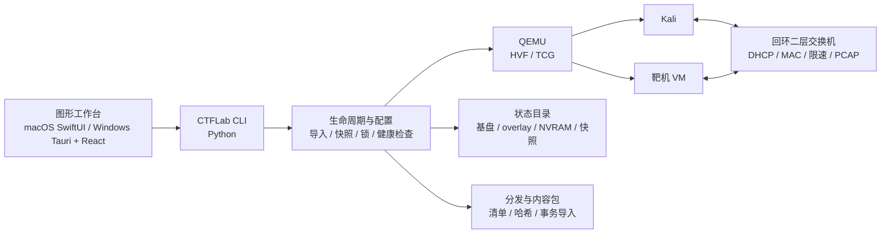

<div align="center">

# CTFLab

### 把可重置的攻防靶场，装进你的电脑

本地 QEMU 靶场运行器 · Apple Silicon Mac 优先 · Windows x64 预览可用

[](https://github.com/zhangpu1211/ctf-lab/releases)
[](#下载)
[](#下载)
[](#从源码运行)
[](LICENSE)

[下载](#下载) · [快速开始](#快速开始) · [项目进度](#项目进度) · [架构](#架构) · [安全边界](#安全边界)

</div>

> [!WARNING]
> CTFLab 目前是**预览版**。Mac 包为 ad-hoc 签名且未公证，Windows 安装器未做 Authenticode 签名，系统可能弹出安全提示。请在确认来源可信后手动放行。
>
> 本项目用于自有设备、课程实验和明确授权的安全测试。不要把脆弱靶机暴露到公网或未经授权的物理局域网。

## 为什么是 CTFLab

传统靶场通常需要手工维护虚拟机、网络、快照和镜像，换一台电脑就要重来。CTFLab 把这些步骤收敛成一条可重复的本地工作流：

- **原始镜像只读**：运行时写入独立 QCOW2 overlay，重置和快照不会破坏母盘。
- **多节点隔离组网**：Kali 与靶机通过回环二层交换机互联，默认不接入真实局域网。
- **图形与命令行共用一套后端**：Mac 使用 SwiftUI，Windows 使用 Tauri + React，CLI 也可独立排障。
- **可分发**：基盘、固件、清单和哈希可打包给课程或团队，接收端先校验再导入。

## 功能亮点

| 能力 | 当前实现 |
| --- | --- |
| 镜像导入 | QCOW2、VMDK、VDI、VHD/VHDX、RAW、OVA；OVA 拒绝越界成员，多磁盘必须显式选择系统盘 |
| 自动识别 | 只读识别固件、分区、候选架构与硬件配置，输出置信度和人工复核状态 |
| 生命周期 | 导入、启动、停止、健康检查、重置、快照、整盘备份与恢复 |
| 存储安全 | 基盘只读、overlay 运行、跨进程锁、快照与 NVRAM 配对校验 |
| 多节点网络 | 回环二层交换机、固定 DHCP、MAC 学习、逐连接限速、可选 PCAP、端口映射 |
| 图形体验 | Kali 默认优先 SPICE 自动分辨率；能力不足时回退 Cocoa；文本剪贴板与拖入文件分别授权 |
| 分发链 | zstd 基盘、`DISTRIBUTION.json`、`SHA256SUMS`、内容包 schema 2、事务导入与失败回滚 |
| 跨平台 | Apple Silicon Mac 原生工作台；Windows x64 Tauri/React 工作台与 NSIS 安装器 |

## 下载

| 平台 | 最新发布 | 说明 |
| --- | --- | --- |
| **macOS 26+ / Apple Silicon** | [v0.1.4-preview.20261102-spice-client-hotfix](https://github.com/zhangpu1211/ctf-lab/releases/tag/v0.1.4-preview.20261102-spice-client-hotfix) | 资产：`CTFLab-0.1.4-preview.20261102-macos-arm64-spice-client-hotfix.zip`。已修复随包 QEMU 的 SPICE 后端与受控 `spicy` 客户端 |
| **Windows x64** | [v0.1.4-preview.20261101](https://github.com/zhangpu1211/ctf-lab/releases/tag/v0.1.4-preview.20261101) | 资产：`CTFLab_0.1.4_x64-setup.exe`。云端 Windows Server 构建、安装、窗口启动和卸载已通过，尚未在 Windows 11 用户机验收 |
| **源码** | [全部 Releases](https://github.com/zhangpu1211/ctf-lab/releases) | 推荐从与发布包对应的标签或 `main` 构建 |

发布页同时提供 `SHA256SUMS.txt`。下载后建议先校验：

```bash
shasum -a 256 -c SHA256SUMS.txt
```

## 快速开始

### 使用打包好的应用

1. 从 [Releases](https://github.com/zhangpu1211/ctf-lab/releases) 下载对应平台的预览包。
2. macOS 首次打开若被系统拦截，前往“系统设置 → 隐私与安全性”手动放行。
3. 在应用中选择**具体的镜像目录**，不要直接选择整个资料库根目录。
4. 导入或启动 Kali，等待健康检查显示 DHCP 与 SSH 可用。
5. 需要恢复实验环境时，先停止节点，再执行重置或恢复快照。

应用内 CLI 位于 `CTFLab.app/Contents/Resources/bin/ctflab-cli`（兼容名 `CTFLab`），
与图形界面共享同一状态目录，便于脚本化与故障排查。Kali 默认通过 user-mode NAT 联网；
靶机实验网仍只经回环交换机隔离。

### 从源码运行

macOS 开发环境需要 Apple Silicon、Python 3.10+、PyYAML 和 QEMU。SPICE 自动分辨率需要带 SPICE 支持的 QEMU；Tesseract 可选，用于增强启动画面识别。

```bash
git clone https://github.com/zhangpu1211/ctf-lab.git
cd ctf-lab

./tools/ctflab doctor
./tools/ctflab import smoke /path/to/smoke.qcow2
./tools/ctflab run smoke
./tools/ctflab health smoke
./tools/ctflab stop smoke
./tools/ctflab reset smoke
```

未知镜像可以先做只读识别，再生成候选配置：

```bash
./tools/ctflab inspect /path/to/machine.ova
./tools/ctflab onboard /path/to/machine.ova --id machine-1
./tools/ctflab probe machine-1 --timeout 180
```

自动识别输出的是**候选事实**，不是“已验证可启动”。低置信度字段、登录状态、来宾网卡和服务仍需人工核对。

### 常用命令

| 命令 | 用途 |
| --- | --- |
| `./tools/ctflab doctor` | 检查宿主依赖、架构与运行环境 |
| `./tools/ctflab network` | 只读查看节点策略、实验网、端口和流量计数 |
| `./tools/ctflab storage` | 查看基盘、overlay、快照、备份和 backing chain |
| `./tools/ctflab snapshot list smoke` | 列出已停止节点的命名快照 |
| `./tools/ctflab reset smoke --backup before-class` | 重置前保存整盘备份 |
| `./tools/ctflab stop --all` | 显式停止所有 CTFLab 节点，用于故障恢复 |

## 项目进度

> 状态口径：**✅ 已完成**表示当前源码、发布包或对应测试/验收已有直接证据；**🟡 部分完成**表示功能已实现，但仍缺少真实平台、最终包或完整场景验收；**⛔ 未完成**表示尚未达到交付条件。

| 模块 | 状态 | 当前结论 |
| --- | --- | --- |
| QEMU 运行时与生命周期 | ✅ | ARM64 使用 HVF，x86_64 在 Apple Silicon 使用 TCG；导入、启动、停止、重置、健康检查已打通 |
| 镜像格式与探测 | ✅ | 常见虚拟磁盘与 OVA 导入、只读识别、候选配置和协议探测已实现 |
| 存储、快照与恢复 | ✅ | 只读基盘、overlay、NVRAM、快照、整盘备份、并发锁与恢复保护已实现 |
| 多节点实验网 | ✅ | 回环交换机、DHCP、MAC 学习、限速、PCAP、端口映射和多节点生命周期已实现 |
| Mac 图形工作台 | ✅ | SwiftUI 原生界面、镜像选择、拓扑草稿、诊断和窗口级检查已有验证 |
| Windows 图形工作台 | 🟡 | 安装器、原生窗口、安装/卸载和载荷检查通过；尚无 Windows 11 真机验收 |
| 显示与输入 | 🟡 | SPICE 自动分辨率、剪贴板、文件拖入和 Cocoa 回退已实现；最新 Mac 热修复包仍需一次真实来宾启动确认 |
| 分发与内容包 | ✅ | 基盘清单、哈希校验、目录式内容包、事务安装和失败回滚已实现 |
| 外部 Kali 二层接入 | 🟡 | 源码、合成端到端和受控 PD Kali 切片已通过；完整宿主组合、真实靶机与故障矩阵仍开放 |
| 安装包与签名 | 🟡 | 预览版可下载；Mac 未公证，Windows 未做 Authenticode，正式发行链未完成 |
| 完整验收门槛 | ⛔ | G0/G1、43 项路线图、真实课程和用户试点尚未整体完成 |

### ✅ 已完成

- [x] Apple Silicon Mac 上的本地 QEMU 靶场运行器
- [x] Kali ARM64 与 x86_64 靶机的导入、启动、停止、重置和健康检查
- [x] 原始镜像只读、独立 overlay、NVRAM 配对、快照和整盘备份
- [x] 回环二层交换机、多节点隔离网络、固定 DHCP、流量计数和 PCAP
- [x] 镜像 `inspect`、`onboard`、`probe` 与启动回退矩阵
- [x] Kali SPICE 自动分辨率、文本剪贴板、拖入文件与 Cocoa 回退
- [x] Mac SwiftUI 工作台与 Windows Tauri/React 工作台源码
- [x] `DISTRIBUTION.json`、`SHA256SUMS`、zstd 基盘和内容包事务导入
- [x] Windows x64 NSIS 安装器的原生构建、安装、窗口启动、载荷核对和卸载 CI
- [x] 0.1.4 双平台预览发布，以及 2026-11-02 Mac SPICE 后端/客户端热修复
- [x] 2026-11-01 记录的全量回归：2364 项、0 失败、23 项条件跳过

### 🚧 未完成

- [ ] 在获准的 **Windows 11 x64 真机**上完成干净安装、WHPX、来宾网络和显示验收
- [ ] 完成 G0/G1 与 43 项路线图中仍为空缺的真实环境判据
- [ ] 在 Windows 上完成升级/回退、关闭窗口后的存续、WebView2 与最终安装包复核
- [ ] 完成 5 名非开发者参与的课堂/用户试点真实反馈
- [ ] 完成外部 Kali 的 Mac + VMware Fusion + Kali ARM64、Windows 11 + VMware Workstation + Kali x64 组合
- [ ] 用真实靶机 VM、QEMU hub、真实故障与性能场景验证外部二层接入
- [ ] 为 Mac 配置 Developer ID 与公证；为 Windows 安装器和二进制配置 Authenticode
- [ ] 在最新 Mac SPICE 客户端热修复包上，由用户重新启动 Kali 并确认真实图形窗口
- [ ] 完成跨 Mac、外接显示器、睡眠/恢复、长时间闲置与持续负载验收
- [ ] 完成 Linux 最终运行包、容器/Docker 来宾和剩余课程场景的真实环境验收
- [ ] 把预览版补丁验证扩展为可重复的正式发布验收，而不是只依赖相邻专项测试

## 架构



## 测试

```bash
# Python 后端与集成测试
python3 -m unittest discover -s tools/tests -v

# 关键入口语法检查
python3 -m py_compile \
  tools/ctflab.py \
  tools/ctflab_inspect.py \
  tools/ctflab_network.py

# Windows / React 工作台
cd desktop
npm test
npm run build
```

测试结果按“单元 / 合成集成 / 真实来宾 / 人工桌面 / 正式发布”分层理解。后一层的通过不能由前一层自动替代。

## 安全边界

- 只在自有设备或明确授权的环境中使用。
- 脆弱靶机默认留在回环隔离网络，不桥接物理局域网，不暴露公网端口。
- 原始镜像保持只读；所有来宾修改写入可恢复的 overlay 或派生副本。
- 在线元数据只能生成白名单候选配置，不能拼接任意 QEMU 参数。
- 虚拟磁盘、凭据、运行日志、课程题库和成绩数据不进入 Git。
- 未完成冷启动、登录、网络、重启和目标服务验证的镜像，不标记为“已适配可用”。

## 参与贡献

- 问题与功能建议：[GitHub Issues](https://github.com/zhangpu1211/ctf-lab/issues)
- 安全漏洞：请通过 [私密安全报告](https://github.com/zhangpu1211/ctf-lab/security/advisories/new) 提交，不要公开披露可利用细节
- 提交 PR 时请说明变更范围、实际测试入口和仍未验证的边界

项目只保留根目录 `README.md` 作为持续状态入口，`PACKAGING.md` 作为 Mac 打包与发布安全门禁。`docs/` 已移除并列入忽略规则，不再上传。

## 许可证

本项目代码以 [MIT License](LICENSE) 发布。随包分发的 QEMU、SPICE、Python 等第三方组件遵循各自许可证；正式分发前请以发布包内的 `THIRD_PARTY_LICENSES.md`、`SBOM.json` 和 `SOURCE_OFFER.md` 为准。

---

<div align="center">

**如果 CTFLab 对你的课程、实验或研究有帮助，欢迎点一个 Star。**

</div>
