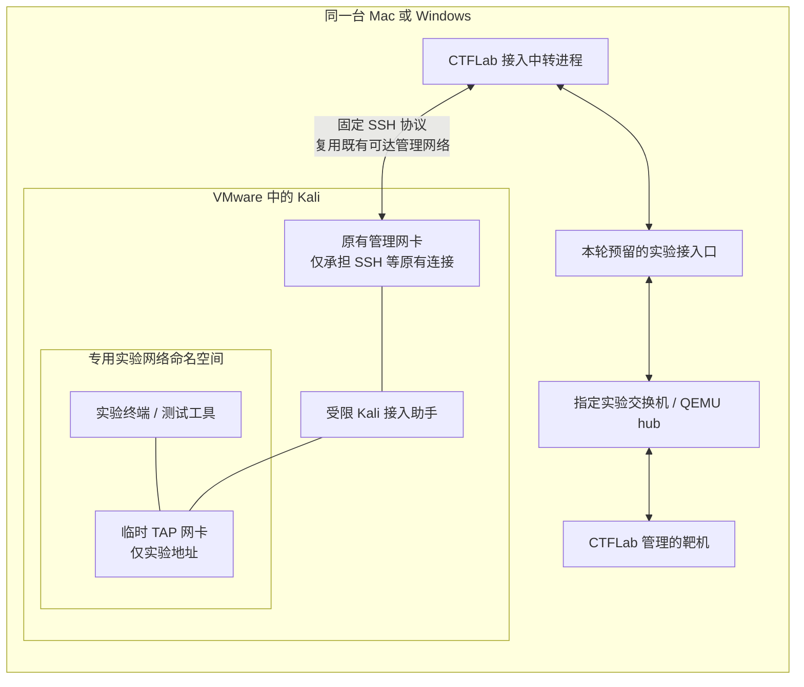
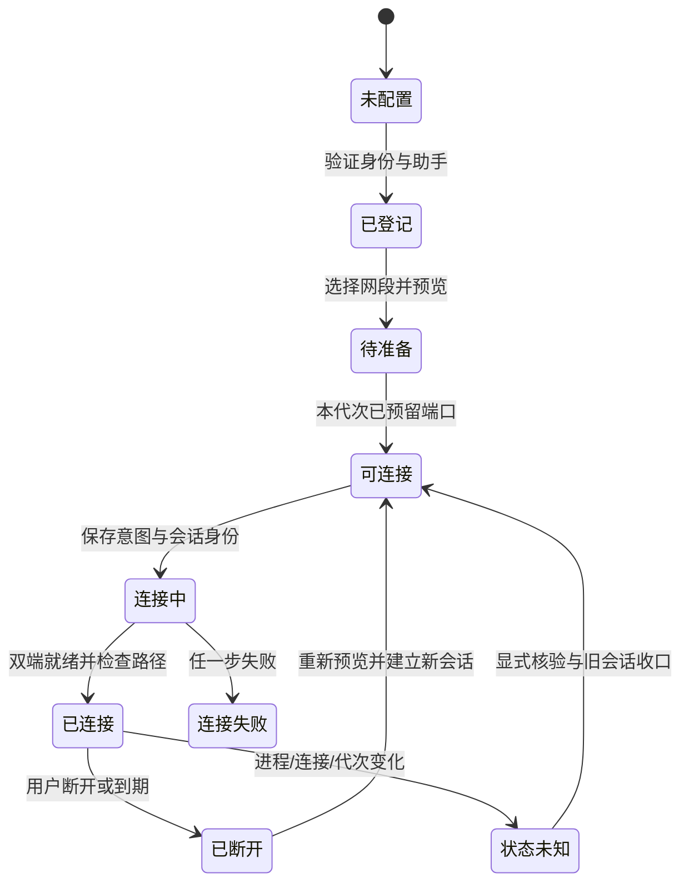

# 同机外部 Kali 接入设计（Mac / Windows）

日期：2026-10-30。状态：设计方案，尚未实施或验收。对应 E01；不改变第144节 Windows ARM 候选的验收范围。

## 1. 交付目标

用户在同一台电脑上运行 VMware 中已有的 Kali 和 CTFLab。Kali 无须导入 CTFLab，进入一个指定实验网段后，可以发现靶机、扫描端口、访问服务，并接收靶机向 Kali 实验地址发起的连接。Kali 的启动、暂停、关机、快照、磁盘始终由用户与 VMware 管理。

建议采用“宿主用户态中转 + SSH 加密传输 + Kali 内专用 TAP 网卡”，首版提供隔离实验终端。Mac/Windows 共用传输与策略，不在宿主安装 TAP/Wintun 驱动、不桥接物理网卡，也不修改宿主默认路由。

这是一套新能力的实现设计，不能把现有 TCP/UDP 服务通道、两端点 IPv4 转送或 Windows ARM 界面检查称为本功能已可用。

### 首版支持范围

| 项目 | 设计范围 |
| --- | --- |
| 宿主 | Apple Silicon Mac；Intel/AMD Windows11 x64，分别实测 |
| 外部 VM | 同机 VMware Fusion / Workstation 中已启动的 Kali Linux，64位 x86_64 / aarch64 分别验证 |
| 并发 | 一个实验网段、一个外部 Kali 会话；已有内部节点互通保持 |
| 网络 | 无 VLAN 的以太网、ARP、IPv4、TCP/UDP/ICMP；实验内固定地址 |
| 使用方式 | Kali 中的专用实验终端；普通桌面终端原网络保持原样 |
| 非首版 | 跨宿主、多外部攻击机、IPv6、VLAN/交换机攻击、任意子网转发、任意网桥、自动互联网出口 |

“同机”首先是用户指定的部署方式，程序不通过扫描局域网寻找设备。主机密钥、来宾身份和双方可达性可以验证连接目标，但不能单靠 SSH 宣称已证明两台 VM 位于同一物理宿主。

## 2. 现有实现与必须补齐的部分

已核对实际源码：

- `tools/ctflab_network.py` 是监听 `127.0.0.1` 的 QEMU 以太帧交换机，使用四字节网络序长度前缀，带 DHCP/静态预约；它不是 VMware 的虚拟交换机。
- `tools/ctflab_qemu_driver.py::network_arguments` 的通用实验网络使用首节点内部 QEMU hub 与回环 socket 星形链路。两个成员时还存在整数端口直连格式。不能向正在被占用的旧直连端口再塞一个客户端。
- `tools/ctflab_external.py` 已有固定 SSH 命令、来宾身份/代次/挑战绑定与命名服务通道；`ctflab_external_ip.py` 的规则围绕固定 IPv4 端点，不等于把 Kali 接入整段实验二层网络。
- `tools/ctflab_remote.py::ssh_arguments` 已限制命令目的、固定 SSH 程序、身份文件和 known_hosts。新协议必须显式加入固定入口，不能让界面传入远程 shell 命令。
- 现有 Linux 身份验证认可部分虚拟硬件供应商；实际 Kali 的 DMI 可读性、Fusion ARM64 的身份来源仍须核验。身份未知时不得自动放宽为仅看 IP。

拟新增内容：外部接入口预约、两类网络后端适配、持续帧传输协议、Kali TAP/命名空间助手、会话监督与回收、Mac/React 接入界面和实机验收。现有 v1 服务通道保持兼容。

## 3. 总体结构

宿主主动连到 Kali 的管理 SSH 地址。实验以太帧承载在该 SSH 会话中，不通过 VMware 网卡直接桥接到靶场，也不向物理局域网开放 QEMU socket。Kali 已有管理网卡不加入实验网桥。

仅使用已经可达的管理网络；如果 Kali 的现有 NAT/Host-only 配置无法被宿主访问，先给出具体缺失项。新增 VMware 网卡、NAT 映射、SSH 服务、密钥或权限属于独立部署动作，不由“连接”按钮静默完成。若需要配置管理通道，优先专用 Host-only 或明确限制在宿主回环的映射，不用 `0.0.0.0` 暴露靶场。

## 4. Kali 侧：把实验流量与原有网络分开

### 4.1 默认使用专用网络命名空间

在 Kali 中创建本会话独占的 network namespace，里面只放 loopback 与临时 TAP。给 TAP 设置预约 MAC、实验 IP/掩码和声明 MTU，不配置默认网关，不复制 Kali 的默认路由，不替换主系统 DNS。命名空间、接口名均从会话 UUID 派生，不接受用户输入作为任意接口或命令名。

TAP 读写以太帧，适合保留 ARP 和同网段发现；已有 TUN 转送 IP 包，不能直接替代此数据面。创建设备需要来宾内受控的网络管理权限，不能宣称普通用户完全免权限。[Linux TUN/TAP 文档](https://docs.kernel.org/networking/tuntap.html)

network namespace 隔离网络设备、路由等网络资源，因此适合避免实验终端意外沿 Kali 原 NAT 出口发送探测流量。这不等于对具有 Kali root 权限的恶意操作者提供不可绕过的沙箱。[Linux network namespace 文档](https://man7.org/linux/man-pages/man7/network_namespaces.7.html)

### 4.2 用户实际怎么使用

连接后在 Kali 显示一条固定助手入口，例如 `ctflab-kali shell <session-id>`（拟议接口，当前不可执行）。用户在专用终端运行工具，靶机看到的是 Kali 的实验 IP；普通终端仍沿用原网络，不能承诺任意已启动应用自动进入靶场。

首版先验证普通 TCP 连接扫描、ARP/ICMP 探测及测试服务；需要原始套接字的 SYN/UDP 扫描，单独授予明确的工具权限。普通实验 shell 进入命名空间后降回调用用户、清除补充组/环境中的特权影响，不交付带 `CAP_SYS_ADMIN` 的通用 root shell。所需 `CAP_NET_RAW` 如何限定到受控工具必须在实现阶段单列测试；不能通过任意 sudo、可写脚本或可继承能力绕开边界。

浏览器、Burp 等图形工具放入后续同一阶段的独立测试项：从实验终端启动全新进程和独立配置，核验真实网络命名空间，避免请求被已有浏览器进程或桌面 portal 接走。首次发布可只声明已测工具，不能把终端连通外推为全部 GUI 工具支持。

### 4.3 权限部署

宿主中转保持当前普通用户权限。Kali 内分离普通 SSH 代理和 root 所有的窄权限网络助手：

1. 用户在 Kali 中明确安装固定版本助手；源码、二进制、配置及祖先目录检查所有者、写权限、链接和摘要。
2. 管理员只允许创建/查询/关闭本工具登记的 TAP/命名空间；助手不提供任意命令、任意 `setns` 路径或任意宿主 PID 参数。
3. 通过私有 Unix socket 及对端凭据校验调用者，再核验会话与实验授权；不依靠环境变量或客户端自报 UID 授权。
4. SSH 使用专用连接密钥、固定主机密钥和专用受限入口；禁止该凭据的通用 shell、代理/X11/端口转发。保留用户已有 SSH 账户和其他密钥。`ForceCommand` 与禁止转发须分别设置，前者不能代替后者。[OpenSSH 配置文档](https://man.openbsd.org/sshd_config)

助手安装与网络配置需要本次部署授权；设计文档本身不视为对任何现有 Kali 的授权。

## 5. 宿主侧：为两种现有网络后端提供接入口

统一一个拟议的 `ExternalAttachProvider`，向中转进程返回绑定实例/代次/网段/预约槽位的帧端点，不接受自由填写的 TCP 目的地址。

| 后端 | 改造方式 | 限制 |
| --- | --- | --- |
| `ctflab_network.py` 交换机 | 准备时预约 external slot；增加受认证的本地接入口，将身份绑定到独立交换端口；复用静态地址管理，外部端口经过额外帧门禁 | 不把已有普通 QEMU 数据口当作认证接口；本地控制使用受保护通道与一次性挑战 |
| 通用 QEMU 内部 hub | 创建新实验代次时为选中网段预留一个额外回环 socket/hubport；由中转作为唯一客户端使用 | 原有二成员直连需改为带预留口的 hub 规划；单成员网段也要有合法预留口，端口总表重新校验 |

QEMU 支持 socket 连接与 hubport，但这仅说明构建这种链路有基础，不证明当前固定版本已经支持拟议生命周期和安全策略。实现须核对项目固定 QEMU 的实际能力。[QEMU 网络参数文档](https://www.qemu.org/docs/master/system/qemu-manpage.html)

首版不热改正在运行的旧实验：

- 未启动的新实验可选“预留外部 Kali 接入口”，参与 manifest/host-profile/端口规划摘要与导入校验。
- 运行中的实验如果已有有效预留口，可以显式连接或断开 Kali，不更改内部节点拓扑。
- 没有预留口时，只显示“下次创建实验代次生效”；不自动停止、重启或重置任何实例。
- 实验首节点或交换机不可用时，外部接入显示失败/未知，不为修复接入自动启动节点。

外部 Kali 不是一个带镜像的受管 VM 节点，不进入镜像导入、启动顺序、整课重置或删除流程。用户草稿仅保存外部接入意图，凭据留在用户私有配置；签名课程包不包含本机密钥或管理地址。

## 6. 会话、数据协议与资源限制

拟新增固定命令 `ctflab-external-l2-v1`；现有 `ctflab-external-v1` 不因旧请求多了字段而自动获得二层权限。客户端 SSH 目的枚举显式扩展，服务端 forced command 固定，拒绝客户端命令替换与未知版本。

会话绑定至少包含：

- 外部节点 UUID、主机密钥指纹、可核验的来宾 machine identity、助手运行时摘要；
- CTFLab instance UUID、generation、network ID、计划摘要、外部端口槽位；
- session UUID、双方 nonce、策略摘要、预约 IP/MAC、到期时间和限额。

来宾 UUID 不支持、重复或无法读取时进入待核验，不能通过关掉身份检查来“支持 Fusion”。DMI、SSH 主机密钥和 root 所有的安装标记是互补绑定；快照恢复后必须重新核验当前助手、代次和挑战。

控制面使用有界 JSON；数据面使用版本化二进制记录，包含类型、长度、会话内单调序号和帧载荷。首版单条以太帧上限1514字节（无FCS/VLAN），短帧规范化后转发；不做逐包“发请求再等回复”。采用双向流式 I/O 和有界队列，控制/心跳不能被扫描流量饿死。超长或错误长度在分配大缓冲区前拒绝，重复/回退序号与错会话记录关闭通道，不重放未知帧。

建议初始默认值：每会话双向队列各256帧、每秒1000帧/20Mbit、突发250帧、累计1GiB、时长2小时。它们是待测的配置目标，不是当前产品容量承诺；UI提前显示额度，超额断开接入并保留内部实验运行。MTU首版1400，双端一致；不得自动降低 Kali 原管理网卡 MTU。SSH 基于 TCP，突发扫描/丢包时可能出现队头阻塞，首轮须实测吞吐与延迟，后续才评估独立 UDP 数据通道。

首版地址采用静态预约，避免增加 DHCP 竞态；实验原有 DHCP 服务保持。先检查实验预约冲突、Kali 命名空间地址与路由、重叠网段、已有同名资源，再落盘连接意图。IP/MAC 必须同时进入连接计划与帧门禁，不能只以交换机 MAC 学习表当授权来源。

## 7. 可达范围与回连

外部端口只允许预览中选定实验网段及其登记节点：

- 从 Kali 发出的 IPv4 源地址必须是预约 IP，源 MAC 是预约 MAC；目的地址只能是当前允许节点及必要的本网段发现地址。
- ARP 请求/回复核对发送方绑定，禁止 Kali 冒充 DHCP、网关或其他节点；拒绝 VLAN、IPv6、LLDP、STP等未授权 EtherType。
- 返回数据核对属于当前网段、当前登记节点；允许靶机向 Kali 预约地址发起新连接，以支持明确的实验回连，不限于已有请求的响应。
- 首版扫描不提供任意 MAC/IP 伪造、IP分片绕过或二层攻击模式。广播发现有速率限制，不能以“全网段”名义越过实际授权节点集合。
- 不自动放通其他实验网段，不修改宿主防火墙，不生成跨网段、默认出口或物理网络路由。

网络命名空间没有原管理网卡，Kali 实验终端默认无互联网出口；Kali 原桌面仍可保留原联网能力。具有 Kali root 权限的操作者仍能主动改变来宾行为，因此不能保证整台任意外部 Kali 的所有程序都隔离。硬边界是 CTFLab 端口策略和不向物理网络提供上联。

界面显示 Kali 的**实验 IP**作为靶机回连地址，并说明只对当前网段有效；不能让用户误用 SSH 管理 IP。真实回连验收使用专用测试监听服务，不以打开 SSH 或查看连接数作为成功。

## 8. 生命周期与恢复

- “SSH已连通”“数据口就绪”“到测试靶机的网络已验证”分别显示，不能用一个绿色状态代替全部验收。
- 已派发请求使用持久意图、会话 UUID 和原始结果绑定。超时先查询旧请求，不换 ID 重试创建资源。
- 断线立即撤销宿主外部端口；新帧拒绝，已在途帧可能到达但不重放。Kali 助手失去租约后只回收自有端点。
- TAP 用独占、非持久接口并贯穿持有 FD；进程退出可回收该设备。命名空间和已经启动的实验进程可能仍有引用，**不能据关闭 TAP 就宣称所有资源已清理**。
- 有实验终端/Burp等进程时，断开只撤网、保留进程，不自动杀工具。明确显示残留会话；用户退出后再验证接口、命名空间引用、地址、路由与原管理网络状态。
- CTFLab退出后由监督器依据租约收口外部通道，保持所有 VM 运行。Windows睡眠、Mac睡眠、VMware暂停/恢复、助手崩溃分别验收，旧 PID 不直接作为以后控制依据。
- 快照、代次变化或实验计划变更使旧接入失效，不把新连接自动接到恢复后的不同实验。

## 9. 界面流程

Mac 原生与 React 桌面共用同一连接模型，建议在“拓扑”页增加“外部攻击机”卡片：

1. **登记 Kali**：显示名称、手动填写 SSH 地址/端口/用户名、选择本地密钥；展示需独立确认的主机密钥，不关闭 known_hosts 校验。
2. **检查环境**：只读报告 Linux/架构、身份、助手版本/摘要、权限、管理通道可达性及所需安装材料。安装助手是独立操作，不混在连接测试里。
3. **选择网段**：显示本次实验/代次、网段名、预约地址、可达靶机、回连范围、限额及隔离说明。
4. **连接**：只在本代次预留口存在、授权与观测新鲜、无并发业务操作时可用；失败显示具体阶段和恢复入口。
5. **使用**：展示“打开 Kali 实验终端”的固定命令和 Kali 实验 IP，说明普通桌面程序不自动接入。
6. **断开**：仅断开外部通道；分别展示已撤网与仍有工具进程。无 Kali 启动/停止/重置按钮。

第一版配置可用私有JSON，但正式交付不能要求学生手写 QEMU 参数、路由或 sudoers。UI 中的名称是用户可理解的“外部攻击机”，协议/端口细节进入诊断展开区。

## 10. 实施拆分与文件边界

以下文件名为拟新增，不表示已有实现。

| 阶段 | 实施内容 | 预计文件范围 | 完成出口 |
| --- | --- | --- | --- |
| A 接入契约 | schema、身份/代次绑定、预留槽位、策略摘要、兼容旧格式 | 新`tools/ctflab_external_attach.py`、scenario/host-profile校验、相关测试 | 草稿到生产计划一致；不产生VM副作用 |
| B 来宾端点 | TAP/命名空间、权限助手、帧门禁、配额与残留报告 | 新`tools/ctflab_external_l2.py`、`tools/ctflab_kali_attach.py`及材料生成 | Linux真内核上创建/断开及原网络保全 |
| C 宿主集成 | 两类网络provider、固定SSH入口、双向流、监督恢复 | network、qemu_driver、remote、生命周期绑定 | 原内部节点互通；外部加入/退出不停止VM |
| D 双端界面 | 接入卡片、权限/状态/恢复、实验终端说明 | React拓扑组件、Swift通用拓扑/模型、桥接协议 | UI不派发越权动作，旧回复失效 |
| E 原生验收/打包 | Mac+Fusion、Windows+Workstation、Kali两架构，原包/新包清单 | 验收材料、打包清单、发布说明 | 以下矩阵通过；单独确认发布范围 |

代码阶段按 A→B→C→D 集成，再集中执行 E。B 的真内核原型应在大规模UI工作前先验证，以免做出无法交付的接入按钮。计划估算为约10—17个有效开发日，前提是两端测试机与专用 Kali 可用；实际接入难度、身份/权限和性能结果可能调整排期，不能承诺一个回合完成全部实机门槛。

## 11. 验收矩阵

| 类别 | 必测 | 通过依据 |
| --- | --- | --- |
| 环境组合 | Apple Silicon Mac+Fusion+Kali ARM64；Windows11 x64+Workstation+Kali x64 | 当前包、当前主机与真实来宾现场记录；不拿Windows ARM代替Windows x64 |
| 两种网络后端 | 旧交换机模式、通用QEMU hub模式；单/双/多成员 | 旧格式回归及新预留口的实际帧往返 |
| 网络业务 | ARP、ping、授权节点端口扫描、HTTP、UDP测试服务、靶机主动回连Kali | Kali及靶机应用层双侧结果，不只有进程或监听端口 |
| 工具权限 | 普通连接扫描、原始套接字工具受控权限；图形应用若声明支持 | 进程netns/身份/能力与实际流量对应，无法逃到默认网络 |
| 拒绝路径 | 错实例/代次/MAC/IP、未授权节点与网段、DHCP冒充、未知协议、VLAN/IPv6、超额 | 非目标服务和抓包计数证明没有送达，不能只看本端报错 |
| 故障 | 断SSH、旧请求重试、双击连接、助手/中转崩溃、宿主/VM睡眠恢复 | 已撤网/未知状态正确，旧包不重放，不能借旧身份重接 |
| 生命周期 | 无预留口的运行实例；首hub节点退出；切换计划/恢复快照 | 不热改或自动停止VM；旧会话失效 |
| 保全 | 原网卡/IP/默认路由/DNS、防火墙、用户工具与镜像 | 前后只读快照一致；仅新建本轮受保护资源 |
| 稳定性/性能 | 普通扫描、小文件传输、突发流量、队列满、2小时会话、磁盘/日志限额 | 有实际测量与失败/丢包计数；不以建议上限当承诺 |
| 清理 | 正常断开、异常退出、残留实验终端 | 宿主口已撤、临时TAP消失；命名空间仍有引用时明确未清完 |

真实安全/隔离负向检查必须用专用验收实例、登记测试目标与可恢复数据。只有接入一台 Kali 的授权，不代表授权扫描物理局域网、停止任何 VM 或修改用户现有网络。

## 12. 首轮开工与发布判断

先建立两个可重复的专用测试组合，固定合法来源的 Kali、SSH主机密钥、助手及 QEMU 版本。第一项可交付实验应是：Kali专用终端通过TAP发现两台登记靶机、访问测试服务、接收一次靶机回连，断开后外部不可达而内部实验继续运行，并证明原管理网未变化。

此实验完成后才进入双端UI和安装包。若性能、Fusion ARM身份或工具权限未达标，保留受限能力与失败证据，调整设计；不能用开放桥接、关闭身份校验或启用任意root shell替代。实施与实机结果另建验证记录，按实际重新打包；本方案不更新当前已发布Mac App或Windows候选，不自动发布。
