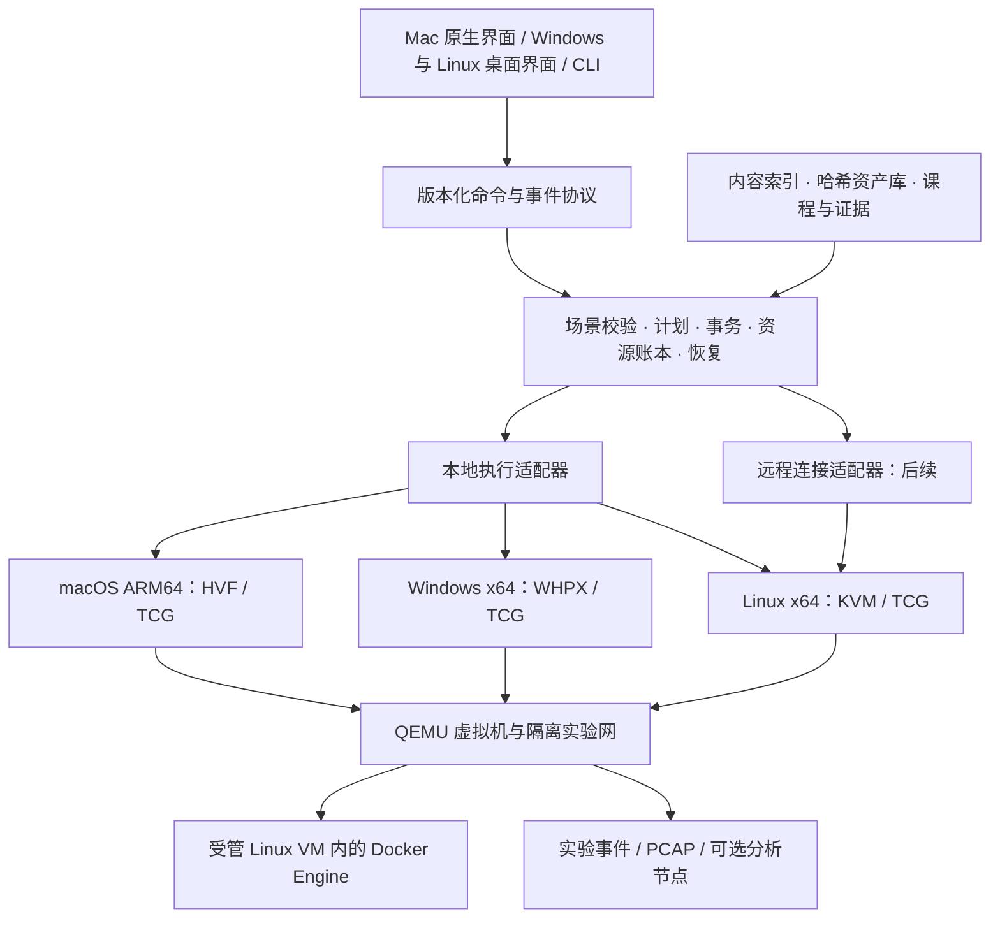

# CTFLab 产品路线与实施原则：教学、Windows 与可扩展实验场景

> 2026-10-21 评审入口：[产品与跨平台方案评审](ctflab-plan-review-2026-10-21.md)。R1—R7 已据此修订规划与依赖，处理状态见评审第7节；没有完成实现或实机风险关闭。Windows 社区预览统一以 [Windows 专项第6节](ctflab-windows-plan-2026-10-15.md#6-windows-社区预览范围与统一验收门槛) 为范围与门槛入口。

> 规划基线：2026-10-15。用户确认“教学与个人练习优先，Windows x64 为下一重点”，并要求覆盖 Windows 渗透、内网多靶机、应急响应。本文是待实施设计，不是能力声明或实机验收记录。正式源码目录为 `/Users/pufei/Downloads/ctf-lab`；调查时 HEAD 为 `0994f62`，已有当前状态文档修改予以保留。
>
> 阅读入口：[Windows 专项设计](ctflab-windows-plan-2026-10-15.md) · [实施任务与验收清单](ctflab-implementation-backlog-2026-10-15.md) · [当前事实与历史验收](ctflab-current-status.md)。后续新增工作的优先级以本方案为准；旧 Mac MVP 路线保留历史背景，实际能力仍以源码、发布产物和日期化验收共同确定。

## 1. 产品目标与关键决定

目标：教师可以把一个实验交给学生，学生能够独立检查环境、进入实验、保存进度、恢复失败、重置和复盘。第一批服务个人电脑和小班教学；远程节点解决低配置电脑与跨架构性能问题，多租户公共平台属于更后阶段。

2026-10-21 补充目标：用户明确希望后续面向社区提供使用。产品定位扩展为“面向教学与个人练习的社区实验工具”；近期仍优先 Windows x64，先让用户在自己的电脑上运行并分享课程/场景，后续按需求发展远程服务。已有公开预览不等于已经满足下述社区自助使用门槛。

本轮确定的顺序：

1. **P0：稳定现有 Mac 主路径，抽离平台接口，并验证 Windows x64 的关键技术风险。** 先证明 Windows 的启动、控制、联网、停止和恢复可行。
2. **P1：先交付 Windows x64 社区预览与完整 C01。** 通用场景契约、只读拓扑、Windows 单机与基础内网样板进入后续 G2，不捆绑 G1；内容配方可独立提前准备。
3. **P2：受控拓扑编辑器、Docker 混合实验、内容目录、证据与流量复盘；补 Linux x64 执行能力。** 各能力按依赖分批交付，不等所有功能完成才发下一版。
4. **P3：单台远程 Linux x64 执行节点、域环境与完整应急响应课程。** 外部接入保留 E01→E02→E03 独立支线，E01 在 S03/S04 后可按课程需求提前，不等 Docker/远程；Windows 主线仍优先。
5. **P4：按实际教学需求扩展 WAF 对照实验、事件关联展示、多人配额和跨站点连接。** 不预设要建设大型云平台。

两个可以提前的支线：离线内容目录可从 P0 开始；静态日志/PCAP 的应急分析实验不依赖 Windows 运行器，可先制作课程内容。若真实学生设备无法承载域实验，应将“Linux 执行节点 + 单人远程运行”提前到 Docker 或完整编辑器之前，不强行按功能数量排期。

### 1.1 社区使用带来的交付要求

社区版本的首要目标是：没有开发者陪同的用户能完成安装、检查设备、导入样板、做完实验、恢复初态，并提供足以定位问题的反馈。社区开放不等待自由拓扑、Docker、域环境或公共云平台全部完成。

| 提前建设的能力 | 社区预览门槛 |
| --- | --- |
| 自助安装与入门 | 固定受支持的 OS/架构和硬件组合；最终包在干净设备完成离线样板；安装、预检失败和卸载保留数据均有中文说明 |
| 版本与兼容 | 区分已验收版本和实验预览；说明运行器、内容格式、课程版本的兼容范围及迁移/回退方式，旧内容不能静默改写 |
| 诊断与反馈 | 本地导出版本、设备能力、实例阶段、结构化错误和必要日志；先脱敏并供用户预览，再由用户选择提交；默认不上传日志、磁盘或流量 |
| 可公开的样板 | 先交付少量完整样板；记录内容来源、分发依据、架构、资源与验证等级；答案和学生包分开 |
| 内容贡献 | 提供场景模板、校验说明、测试结果模板和贡献流程；社区内容与维护者已验收内容分别标识，提交不等于自动收录或可信 |
| 持续维护 | 明确支持范围、已知问题、发布记录和问题分流；普通使用问题与运行器安全缺陷提供不同反馈入口 |

软件安装包、课程说明/场景配方、系统镜像分别管理。仓库自身代码的现有许可不改动；第三方镜像与工具按各自分发依据处理，未核验内容不进入公开样板。Windows 内容沿用自备介质与制作配方路线。用户可共享拓扑、元数据和教程，贡献格式不开放任意宿主命令执行。

首个 Windows 社区预览固定交付一套 C01 基础 Linux/Web 课程，C05 应急证据分析可另行准备但不阻断 G1。邀请 5—10 名未参与开发者试用，至少5名按教程独立完成最终候选包 C01，保留全部失败/人工介入及阻塞问题复验记录。同一版本的支持声明只覆盖实际验收组合；Windows 单机、内网与域课程按各自门槛加入。

维护入口先复用现有代码托管：问题模板收集版本、平台、课程、复现步骤与脱敏诊断；使用讨论承接教程与交流。GitHub 的 issue forms 支持结构化输入和字段验证，可作为候选实现；本轮不创建或启用远端入口。[GitHub issue forms 官方说明](https://docs.github.com/en/communities/using-templates-to-encourage-useful-issues-and-pull-requests/syntax-for-issue-forms)

任务见 U01—U04，其 C01 首版要求已纳入 G1，不再并列两套标准。自助使用、诊断脱敏、样板取得/分发依据和维护反馈都是 G1 硬门槛；公开预览需要签名与最终包验收，未签名包只能用于明确参与者的封闭试点。U03 不要求内容市场。设备数量、证据和例外边界统一见 Windows 专项第6节，不改变 Windows 优先及 E01→E02→E03 的顺序。

## 2. 现状与真实差距

以下为源码和既有记录核对，本轮没有重跑 VM 或确认新的业务可用性。

| 能力 | 当前依据 | 后续需要补齐 |
| --- | --- | --- |
| Mac 本地虚拟机、只读基盘、overlay、导入校验 | `tools/ctflab.py`、`tools/ctflab_dist.py`；状态第 50、52 节 | 跨设备体验、失败恢复一致性、最终包验收 |
| Windows/Linux 运行器 | 主入口直接导入 `fcntl`，doctor 限制 Darwin arm64 | 平台接口与各宿主实机验证，不能只换 QEMU 文件 |
| 多网段场景 | `tools/ctflab_scenario.py` 的校验器固定 wintermute、三节点、outer/inner 两网 | 通用场景契约、任意受限 DAG、资源约束及兼容迁移 |
| 场景加速器 | `qemu_node_command` 按客体架构直接选择 ARM→HVF、x86→TCG | 联合宿主系统、宿主架构、客体架构、运行时能力选择 |
| 锁、进程与网络资源 | `ctflab_scenario_resources.py` 使用 flock、POSIX 权限、监听 FD；runtime 使用 `/bin/ps` 和 UNIX socket | Windows 锁/ACL/进程身份/控制端点/套接字交接 |
| GUI | `gui/GuiApp.swift` 为 SwiftUI/AppKit | Windows/Linux 界面与一致的业务协议 |
| 内容包 | schema 2 profile 包、schema 3 场景包 | 多架构资产选择、签名目录、课程与证据元数据 |
| 流量采集 | `ctflab_network.py` 有 Ethernet PCAP 写出 | 配额、覆盖范围、丢包指标、事件关联与分析界面 |
| 发布 | 记录为 v0.1.2-preview.20261015，库内软件已归并 | Windows 安装/签名，跨平台包级验收；Mac 公证仍未做 |

源码定位：[场景契约](../tools/ctflab_scenario.py)、[生产运行时](../tools/ctflab_scenario_runtime.py)、[资源准备](../tools/ctflab_scenario_resources.py)、[内容包](../tools/ctflab_dist.py)、[网络](../tools/ctflab_network.py)、[Mac GUI](../gui/GuiApp.swift)。不能把“已实现 Wintermute”写成“已有通用拓扑编辑引擎”。

## 3. 用户参考图的逐项转化

参考图为用户提供的 LingJing 架构示意。实线/虚线和“已实现”只属于图中产品的说明，本轮未验证该产品；图中名称、图标和实现状态均不作为 CTFLab 已有能力。以下提取功能需求，不复制品牌或界面素材。

| 图中能力 | CTFLab 对应方案 | 首个可交付范围 | 优先级/依赖 |
| --- | --- | --- | --- |
| 本地靶机启动 | 场景与单机统一生命周期 | 准备、启动、健康、停止、重置、恢复 | P0/P1 |
| Windows AMD64、Mac ARM64 | 宿主平台适配器 + 能力探测 | Mac 现状保留，Windows 11 x64 下一重点 | P0/P1 |
| ARM64、AMD64 靶机环境 | 每个逻辑节点声明架构变体和实际镜像哈希 | Kali 按宿主选已验收变体，靶机保持教学所需架构 | P1 |
| 网盘靶机导入 | 本地文件/目录导入；后续下载适配器 | 用户先用官方客户端下载，再校验导入 | P1；自动下载 P2 |
| 下载靶机到本地 | 可信目录 + 缓存 + 断点续传 | 一个 HTTPS 内容源和一个离线目录 | P2 |
| 分布式镜像服务器 | 不可变哈希对象 + 签名索引 + 镜像地址 | 单源先行，再加校内只读镜像 | P2→P3 |
| 常规漏洞、综合实战 | 课程包 + 已验证模板 | 单机、基础内网、Windows 单机各一个 | P1/P2 |
| 内网、域环境 | 多网段、路由策略、DNS/时间依赖、域控恢复契约 | 隔离的单域、单 DC、成员机与攻击机 | P2/P3 |
| 内置 Attacker | 按架构分发 Kali 工具节点 | 桌面/终端、工具版本与资源说明 | P1 |
| 本地路由 | 场景专属路由器节点或受控网关 | 仅连接声明的实验网，不接物理网卡 | P2 |
| 外部虚拟机 Attacker | 独立接入适配器 | 先手动启动外部 Kali，再接入指定实验网 | S03/S04 后独立推进，不属 G1 |
| 全流量分析 | 实验网采集 + PCAP 导出 + 可选分析器 | 明确捕获网段/时段，支持离线复盘 | 基础 P1；分析 P2 |
| WAF | 可选反向代理教学节点 | 观察模式与阻断模式对照实验 | P4，可按课程提前 |
| 态势感知 | 实验事件与告警时间线 | 关联节点、流、规则、证据来源 | P3/P4 |
| 云端启动靶场 | 远程 Runner | 一台自有 Linux x64 节点，整场景放在同一节点 | P3 |
| 本地/云端路由互联 | 独立的数据通道与路由策略 | 第一版只做远程桌面；确有需求再做窄范围隧道 | P4 |
| 渗透实景模拟 | 多角色课程包与事件注入 | 固定初始状态、学习任务、检查点、教师参考答案 | P2/P3 |

“全流量”应在产品中表述为“所选实验网捕获范围内的流量”；没有覆盖的网段、加密内容和捕获丢包必须可见。流量告警不自动等于实验完成或真实入侵结论。

## 4. 总体架构

保留 Python 编排内核与现有 Mac GUI，按边界逐步迁移。新增平台共享业务语义，避免分别维护三套启动/恢复逻辑。

图表示模块依赖，不表示所有网络互通。控制平面只由受信任运行器使用；学生所在实验网不能访问宿主控制接口。远程版第一阶段以“一个场景一个执行节点”为单位，不跨宿主拉伸二层网络。

### 4.1 平台接口与运行协议

建议接口：`HostCapabilities`、`ProcessSupervisor`、`StateLock`、`PrivateStorage`、`ControlTransport`、`NetworkBackend`、`DisplayBackend`、`RuntimeBundle`。这些是拟新增接口名，并非现有 API。

- 核心只表达启动计划、节点依赖、资源需求、停止策略和代次；平台实现执行细节。
- 命令至少携带协议版本、实例 UUID、代次、操作 ID、幂等键和预期状态版本。`status` 不产生写入；重复 `start` 不产生第二实例。
- 长操作返回阶段与结构化错误：原因、已完成步骤、现场是否保留、可选恢复动作。只有确切总量才显示百分比。
- 事件区分准备完成、进程运行、来宾启动、服务就绪、实验检查通过；失败与未知状态单独保留。
- 本地优先使用私有 IPC。Windows 见专项设计；远程先通过已认证 SSH 承载受限 Runner 协议，后续才引入长期服务和 mTLS。
- GUI、CLI、远程入口都调用同一业务服务，不从界面拼接任意 shell 或 QEMU 参数。
- 当前日志与资源账本先保留格式；需改存储时版本化迁移并保留旧副本。恢复判断继续基于真实资源身份，不仅依据日志中的 PID。

### 4.2 桌面界面选择

建议 Windows/Linux 新界面采用 **Tauri 2 + TypeScript/React + Python sidecar**；拓扑采用 React Flow。这是基于跨平台界面、拓扑复用和现有 Python 内核的工程选择，须先通过小型原型验证；不要求重写 Python 为 Rust。Tauri 支持随包外部程序，React Flow 提供节点/连线编辑基础。[Tauri sidecar](https://v2.tauri.app/develop/sidecar/)、[React Flow](https://reactflow.dev/learn)

原型只验证：随包 Python 启动、命令/事件收发、取消、中文路径、离线 WebView2、窗口关闭后运行器继续受控。原型未通过前保留 CLI，不仓促扩大界面工程；Mac 原生界面继续使用，共享界面是否替代它由后续维护成本与体验数据决定。

远端网页和实验 Web 页面不进入拥有本地 IPC 权限的应用窗口；内容说明按不可信文本处理，限制 HTML、外链和脚本。Tauri sidecar 只允许启动固定运行器，不开放通用命令执行。

## 5. 通用场景与拓扑编辑器

### 5.1 先建立可执行契约

当前“内容包 schema 3”与“场景 manifest schema 1”是两个版本体系。新通用场景拟称 `scenario-v2`；新增容器资产角色或不兼容结构时，应另外提升内容包格式版本，不在旧 schema 中偷偷改变语义。现有 Wintermute v1 保留兼容解析器与原验收记录。

通用场景至少描述：

| 分组 | 字段语义 |
| --- | --- |
| 身份与兼容 | 场景 ID/版本、所需运行器版本、能力列表、学习目标 |
| 资产 | 不可变哈希、来源、许可、客体 OS/架构、已验收宿主组合、固件与驱动要求 |
| 节点 | 类型、资产、资源上限、网卡、显示、依赖、就绪检查、停止策略 |
| 网络 | 子网、地址租约、二层域、路由器、DNS/时间服务、显式允许与禁止路径 |
| 生命周期 | 依赖 DAG、超时、失败保留、重置策略、外部资源所有权 |
| 教学 | 学生说明、分级提示、检查点、教师答案的独立分发引用 |
| 观测 | 捕获点、日志类型、配额、保留期、证据导出策略 |
| 展示 | 坐标与分组单独存储，不参与网络语义或执行参数 |

解析与计划阶段无副作用；先展示资源预算、架构选择与网络变化。拒绝未知参数、循环依赖、重复 MAC/IP、重叠网段、越权挂载和缺失资产。对于使用固定 IP 的旧靶机，不能只改清单自动换网段；必须存在已验证的来宾配置路径，否则明确提示冲突并拒绝启动。

多架构意味着“同一课程模板可以选择不同的已验证资产”，不保证同一磁盘在各宿主上性能一致，更不保证 ARM 与 x64 的漏洞和系统行为等价。Kali 可设变体；依赖特定系统或二进制的靶机保持指定架构。

### 5.2 分三次交付界面

1. **只读拓扑**：画出实际节点、网段、IP、状态、允许路径，点击节点打开服务/控制台。展示“设计连线”和“现场观测状态”的区别。
2. **模板编辑**：仅支持已注册节点模板、网段、连接和资源调整。保存前编译、校验、显示差异；运行中场景编辑产生新草稿，下一代次才生效。
3. **进阶编辑**：多网卡路由器、域环境、Docker 节点、观测点、导入导出与撤销重做。变更默认重新部署，不先实现热插拔和在线改路由。

验收核心：图→清单→图语义一致；相同清单生成等价计划；非法图不能开始执行；导出包在另一台受支持电脑重现节点、网络和教学入口。画布可以拖动不算编辑器完成。

## 6. Docker：先统一执行边界，再做混合网络

### 6.1 推荐第一种后端

在 Mac/Windows 上，先让 Docker Engine 运行于 **CTFLab 管理的专用 Linux 虚拟机**。一个实验实例拥有自己的容器宿主 VM，内部可以有多个容器。Linux 宿主初期也可使用同一方式；共享宿主 Docker Engine 仅在后续可信单用户模式评估。

选择理由：延续现有 QEMU 生命周期；不依赖学生已安装 Docker Desktop；能控制实验网、磁盘和重置；容器逃逸风险不会仅靠容器自身边界承担。代价是增加 VM 内存、启动时间、Linux 基盘维护和更新成本，必须计入资源预检。

Docker Desktop 的 Linux 容器由其 VM 和网络后端承载，不能假定容器桥接网就是 CTFLab 的 QEMU 二层网；发布端口还可能暴露到宿主接口。因此 Desktop 接入保留为后续独立适配器。[Docker Desktop 网络](https://docs.docker.com/desktop/features/networking/)

### 6.2 分两步实现

- **D1 独立容器实验**：在容器宿主 VM 内运行攻击工具终端与一组 Web/数据库容器；只提供受控终端/必要服务入口，先证明创建、检查、停止、重置和离线载入。
- **D2 VM + Docker 混合**：Kali VM → CTFLab 实验交换机 → 容器宿主 VM 实验网卡 → 显式路由/防火墙 → 内部容器网络。优先实现三层可达；ARP、广播、原始二层实验另设能力声明，不能用端口代理冒充完整内网。

容器宿主 VM 的控制通道使用受限的串口/virtio 通道等候选机制，按白名单操作；通道不转发通用 shell，不在实验网暴露 Docker API。实验运行时默认无 NAT 出口。下载/更新在独立内容准备阶段完成，再把校验后的 OCI 归档交给执行节点。

### 6.3 内容和生命周期约束

- 采用镜像 digest 固定版本，并解析多架构索引中的具体变体；记录最终 digest，不用浮动 `latest` 作为验收依据。跨架构模拟只作显式兼容模式。[Docker 多平台镜像](https://docs.docker.com/build/building/multi-platform/)
- 首版只接收受限声明。Compose 可作为受控导入格式，不能原样执行任意 Compose；拒绝构建脚本、特权、宿主网络/PID/IPC、Docker socket、任意宿主挂载和外部卷。
- 容器 `command` 仅作用于已审核镜像内部；不变成宿主命令。实验需要的额外能力在模板中明确声明，不全局关闭隔离限制。
- 每个容器、网络、卷绑定实例 UUID、代次、操作 ID；清理同时核对账本和真实所有权，不能按名称前缀批量删用户资源。
- 默认内部网络；但 `internal: true` 不能独自证明所有逃逸路径均被阻断，需测试双网卡、网关、IPv6、宿主服务及控制通道。[Compose 网络](https://docs.docker.com/reference/compose-file/networks/)、[Docker 安全模型](https://docs.docker.com/engine/security/)
- 重置将容器数据卷与 VM overlay 一起换到新代次；停止完成、完整准备与单一活动指针提交构成事务。不能把多个文件系统对象写入称为天然原子操作。

最小验收场景：Kali/工具节点、Web 容器、数据库容器；验证 Web 可达、数据库仅按设计可达、目标无公网/物理 LAN 出口、重置恢复初始数据、另一实验不受影响。

## 7. 内容分发、镜像库与存储

先做离线目录和单个 HTTPS 源，随后增加校内只读镜像；“分布式”首先表示同一不可变对象的多个下载地址，不表示必须自建复杂集群。

- 内容索引只含元数据与允许的下载引用，不含宿主命令、口令或任意安装钩子。
- 基盘以哈希定位，运行实例只持有只读引用和可写副本；垃圾回收先计算基盘、overlay、快照、备份、下载临时文件的依赖。
- 下载使用 partial 文件、长度限制、断点校验、完整哈希后再发布到缓存；来源变更、重定向和代理均重新验证策略。
- HTTPS 解决传输，哈希解决字节完整性；发布者真实性与索引回滚需要签名元数据。采用成熟的 TUF 方案，设计根信任、签名角色、轮换、过期处理和离线目录信任，不自创签名协议。[TUF 概览](https://theupdateframework.io/docs/overview/)
- 网盘第一版以人工下载接本地导入；后续只接有官方接口与明确许可的服务，访问凭据进系统凭据库，不写入包或日志。
- Windows 商业系统默认提供制作配方与用户自备安装介质；校内镜像是否可分发依据相应许可确认。现有第三方场景包的本地使用不自动产生公开再分发权。
- 空间估算同时考虑下载、解压、导入、overlay 增长、保留快照和 PCAP。共享缓存节省空间不以降低原盘保护为代价。
- 第一版跨电脑迁移支持内容包与关闭状态下经过验证的磁盘导出；不承诺跨 QEMU 版本、宿主架构或加速器恢复内存快照。

P03 分成本地与在线两个切片：本地空间预检、引用保护、进度/旧代次/证据保留随 W02/W03 生命周期进入 G1，不依赖 P02；超出 C01 的通用多节点扩展随 S03。在线下载缓存回收依赖 P02，单独验收。O01 只依赖 P03 本地能力；G1 不要求快照产品、自动回收或完整流量分析。

## 8. 流量、WAF 与事件展示

建议顺序：现有 PCAP 的可靠导出 → 实验事件时间线 → 离线分析 → 可选在线传感器 → WAF 与综合展示。

| 层次 | 实现边界 | 完成标准 |
| --- | --- | --- |
| 采集 | 场景交换机/网关捕获；按实例分卷和限额 | 明确捕获点、时间范围、丢包/截断与文件哈希 |
| 时间线 | 生命周期事件、操作记录、就绪检查与流量引用 | 同一时间基准，能回溯到原始证据 |
| 协议分析 | 固定版本 Zeek 或 Suricata，在受管分析环境中离线读取 | 同一输入与规则版本可复现，异常 PCAP 不影响运行器 |
| 告警 | 导入 Suricata EVE 等结构化事件 | 显示规则版本、原始事件、误报说明，不自动判分 |
| WAF | 独立代理节点接入 OWASP CRS 等规则 | 明确 HTTP(S) 覆盖范围、观察/阻断开关和对照结果 |
| 展示 | 节点、连接、事件与时间范围过滤 | 能回答“哪台机器、何时、有什么证据” |

Zeek 能离线处理 PCAP，Suricata 提供 EVE JSON，CRS 提供可接入的 Web 防护规则；这些用于复用分析能力，不意味着 CTFLab 已集成。[Zeek 官方示例](https://zeek.org/2020/01/getting-started-with-zeek-docker-style-part-1/)、[Suricata EVE](https://docs.suricata.io/en/latest/output/eve/eve-json-output.html)、[OWASP CRS](https://coreruleset.org/docs/1-getting-started/)

采集默认限定实验环境，不采宿主整机流量；原始日志/PCAP 可能含实验凭据，导出时给出范围和脱敏选项，保留原证据与脱敏副本的区别。TLS 解密若是课程目标，显式使用实验专用证书/密钥；不默认安装宿主根证书。WAF 是可选教学节点，不能默认拦截所有实验请求、改变原靶机漏洞表现。

## 9. Linux、远程运行与外部虚拟机

### 9.1 Linux 的实施顺序

先 Linux x64 CLI/Runner，再决定是否提供完整桌面。选择一个受维护发行版作为首个验收基线，锁定 QEMU/固件/显示客户端版本；不是一次承诺所有 Linux 发行版。优先 KVM，缺少硬件加速时明确兼容模式，资源不足可拒绝重型实验。

普通用户运行 QEMU；需要的设备权限与受限网络辅助工具单独配置，不让整个桌面应用以 root 运行。远程多人阶段再增加专属用户/命名空间/cgroup 等边界。QEMU 官方明确区分硬件虚拟化与 TCG 的安全支持范围，因此不能把本地 TCG 加回环网络宣传成可承载不可信多租户的完整安全边界。[QEMU 安全说明](https://www.qemu.org/docs/master/system/security.html)

### 9.2 第一版远程能力

场景中的 Kali、Windows 靶机、域控与实验网全部在同一台自有 Linux x64 主机运行，客户端接收状态、日志与桌面。这样可先解决 Mac 运行重型 x64 实验的性能问题，无需先实现跨云路由。

- 通过固定主机身份的 SSH 连接受限 Runner 协议；保存主机公钥信任，不忽略主机密钥变化。只执行固定服务入口，不拼接任意远端 shell。
- 凭据存储在系统凭据库；身份、实例归属、操作幂等与版本兼容在服务端验证。网络可达不等于操作授权。
- 显示经受控隧道或鉴权网关，禁止直接公开 QMP、SPICE、VNC、Docker API；每个会话有独立授权和到期时间。
- 断网时不立即销毁实验；服务端保持状态，客户端重连继续查看。超时停止/回收采用用户可见的租约策略，保留证据和运行盘。
- 先导入资产并验证哈希再启动；不将大型 QCOW2 放在跨公网共享文件系统上直接运行，不实现实时迁移。
- 远端控制网络与实验网络分离，防止来宾访问云元数据、管理接口、其他租户和物理 LAN；验证后才能提供受限教学服务。

第一阶段不做自动购买云服务器、计费、多地域调度或 Kubernetes。多人版本再增加教师/学生/管理员权限、每人实例、配额、公平调度、审计和恢复演练。

### 9.3 外部 VM 与本地/远程网络连接

外部 Kali 首先由用户在原虚拟化软件中启动；CTFLab 只提供指定实验网的接入信息。后续逐个实现 UTM/VMware/VirtualBox 等连接器，不默认操控所有外部 VM。

**2026-10-21 用户确认的接入顺序：**

1. **E01 外部 Kali**：先接 VMware 或 VirtualBox 中已有的 Kali，让它访问 CTFLab 实验靶机；另一虚拟化软件作为独立适配组合验收。
2. **E02 外部 Windows 单机**：让 CTFLab 中的 Kali/分析节点访问 VMware 或 VirtualBox 的 Windows 实验机，支持指定实验服务与日志采集。
3. **E03 外部域环境**：在 E02 通过后接入域控、成员机和业务机，验证路由、DNS、时间、域服务及教学路径。

初期外部虚拟机仍由原软件启动、停止、快照与恢复；CTFLab 负责接入、连接状态、访问策略和检查。网络接入不等于已获得外部实例的生命周期控制权。跨两套软件的整场景恢复须有协调步骤：记录外部基线/恢复点和内部代次，暂停实验连接，分别完成恢复并核验一致性，再重新开放连接；不能将 CTFLab 单方重置称为全场景重置。自动管理外部 VM 另行设计，当前不纳入 E01—E03。

优先采用外部 Kali 到专属接入网关的三层隧道。路由只包含明确实验 CIDR，并同时配置网关防火墙；不下发默认路由，不桥接真实办公网。WireGuard 可作为数据通道候选，但它不代替用户授权、网络策略或实例归属校验。[WireGuard 官方说明](https://www.wireguard.com/quickstart/)

首版接入需验证双向应用通信、回连、DNS、MTU、路由冲突、退出后规则清理及 CTFLab 所控网关路径上的宿主/LAN 禁通。登记外部 VM 标识、网卡、路由、对等端与服务；额外 NAT/桥接出口无法核验时，不承诺外部 VM 所有路径或全场景隔离。连接状态与隔离验证状态分别显示，身份、路由或网卡变化及断线均重新检查；完全封闭课程须使用所有接口受控的模板，来宾脚本不能单独证明强隔离。

同宿主接入分别验收 QEMU/WHPX + Workstation、QEMU/WHPX + VirtualBox 的版本与安全功能组合，先支持一个通过组合，不要求三引擎同时运行。W01 仅做轻量探针，E01 完成单独/同时运行、课堂响应和睡眠恢复；异宿主另列矩阵，不默认关闭宿主安全功能。未测组合不作共存承诺，G1 本身不包含外部接入。

需要广播或二层协议的课程，优先保持相关节点在同一受控二层实验网；不能把三层隧道称为二层透明互联。域环境按实际使用的 DNS、时间、认证和应用协议逐项验收，不以 ping 成功或是否同一宿主判断完整可用。

## 10. 三类教学方向的落地方案

### 10.1 Windows 渗透与域环境

**可以作为产品目标，但本轮尚未实现或验收 Windows 靶机。** Windows 宿主适配与 Windows 来宾支持分别验收。x64 Windows 宿主运行 x64 来宾优先 WHPX；Mac ARM64 本地运行 x64 Windows 使用模拟，适合经过性能验证的小场景；完整域环境优先 x64 本地机器或远程 Linux KVM 节点。

先单机，再单域：攻击机、Windows 成员机、域控/DNS，必要时增加独立应用服务器。课程涵盖授权实验内的服务枚举、身份与权限配置问题、横向访问路径、审计和防护对照；具体实验流程与成功检查放在课程包，平台本体不内置自动攻击流程。

制作与验收要求：

- 学校/用户提供合法介质或按官方评估条款使用；记录版本、补丁、驱动、激活/到期信息与允许分发范围。微软提供 Windows Server 评估介质，但评估下载不自动等于可公开再分发或永久使用。[Microsoft Evaluation Center](https://www.microsoft.com/en-us/evalcenter/download-windows-server-2025)
- Windows 11 来宾所需的固件、安全启动、vTPM 等按选定版本核验；vTPM 状态与磁盘、NVRAM 成组恢复。不能为兼容而默认绕过系统要求。
- 控制台首次登录可用；RDP 只在实验网或鉴权显示通道内提供。没有 RDP 服务不能被误报成系统未启动。
- 域环境先启动 DNS/DC，确认服务和时间同步，再启动成员机和应用；时间、DNS、机器账户与日志必须作为健康检查。
- 单机运行不证明 AD 可用。域控恢复需实现并验收 VM-Generation ID 语义和来宾支持；QEMU 有该设备，AD 的恢复保护依赖虚拟化平台正确暴露标识。[QEMU VMGenID](https://www.qemu.org/docs/master/specs/vmgenid.html)、[Microsoft 虚拟域控架构](https://learn.microsoft.com/en-us/windows-server/identity/ad-ds/get-started/virtual-dc/virtualized-domain-controller-architecture)
- 初版仅支持整个实验关闭后，从已验证一致基线重置全场景；没有完成 AD 恢复验收前，禁用任意单台 DC 快照回滚。保留旧代次以恢复，课程重置不能替代真实生产域备份。

R5 的独立门槛归 C04/E03：单 DC、全域冷基线恢复分别覆盖无健康复制伙伴的样本；固定 Server/QEMU/固件和全套状态规则，连续恢复检查 SYSVOL/NETLOGON、DNS、时间、机器账户安全通道、新发起的域认证及课程业务。已有会话不算重新认证，不以固定 VMGenID 绕过保护；失败保留现场。该门槛不阻止 C01 或 Windows 宿主预览。

### 10.2 内网多靶机

从“攻击机—入口机—内部服务”扩展到 Web、数据库、文件服务、域控等角色。拓扑连线表示网卡接入，访问策略表示是否允许，二者分开。多网卡本身不意味着自动路由；入口机转发是否启用由课程声明。

每个场景随附可达性矩阵：源节点、目标节点/服务、应通或禁通、前置条件、验证方式。示例：Kali→入口 Web 可达、Kali→内部数据库禁通、指定业务机→数据库可达、所有靶机→宿主控制面/公网/物理 LAN 禁通。实验任务改变路由或访问路径后，保存新的观测证据，不覆盖初始矩阵。

先验证 3—5 节点与两个网段，再扩大规模；按测得的内存、CPU、磁盘 IOPS 和启动时长确定设备等级。声明的 vCPU/内存总量只是预算，还需记录宿主实际峰值，不将预约额度视为资源隔离已经生效。

### 10.3 应急响应与取证复盘

分两种交付：**证据包实验**和**可操作现场实验**。证据包可立即进入内容制作；现场实验依赖对应来宾、采集和一致重置能力。

- 证据包：Windows 事件日志、可选 Sysmon、Linux 系统/认证/服务日志、Web 日志、PCAP、磁盘或内存样本、主机清单与时间说明。
- 可操作现场：正常基线 → 固定版本的受控事件生成 → 调查现场；先封存证据，再在派生副本进行隔离、修复和验证。需要有“保留现场”与“重置”两个明确不同的操作。
- 首批使用合成日志、无害事件生成器、已审核样本；不需要传播性或破坏性恶意程序来完成课程目标。事件生成由教师显式执行，只作用于实验实例。
- 证据原件只读；采集记录来源、UTC 时间与时区、工具版本、哈希、实例/代次、采集动作和操作者。活体采集会改变现场，应在记录中说明。
- 内存证据先支持离线导入或受控来宾工具输出；不能把普通 QEMU 内存转储直接当成所有取证工具可识别的格式，需按 Windows/Linux 与工具版本单独验证。
- 教师真值、注入时间线和答案与学生材料分别分发；本地包不能假设隐藏字段能对学生保密。考核评分优先人工复核，检查点只辅助。
- 统一展示调查发现、证据引用、处置动作和验证结果；不把“发现告警”当成完成根因分析。

Sysmon 可记录 Windows 系统活动并写入 Windows 事件日志，可作为选配观测来源；安装规则、性能影响及事件覆盖需要随实验验收。[Microsoft Sysmon](https://learn.microsoft.com/sysinternals/downloads/sysmon)

### 10.4 首批课程模板

| 模板 | 建议组成 | 首次验收重点 | 依赖 |
| --- | --- | --- | --- |
| C01 基础 Web | Kali + 已有 Linux 靶机 | 学生从安装到实验、停止和重置 | Mac 基线 / Windows MVP |
| C02 Windows 单机 | Kali + Windows x64 | 系统/服务、控制台、授权介质、日志、重置 | Windows 来宾适配 |
| C03 内网双网段 | Kali + 双网入口机 + 内部服务 | 初始可达矩阵、受控转发、全场景恢复 | 通用场景 v2 |
| C04 基础域 | Kali + DC/DNS + 成员机，可再加应用机 | DNS、时间、域登录、审计、整场景重置 | C02/C03 + AD 恢复 |
| C05 应急证据分析 | 日志/PCAP/磁盘样本 + 分析工具 | 原证据只读、时间线、报告引用 | 内容规范即可开始 |
| C06 Windows 应急现场 | Windows 业务机 + 日志收集/分析节点 | 现场封存、采集、派生副本处置、恢复验证 | C02 + 证据能力 |
| C07 Web 防护对照 | 工具节点 + WAF + Web/数据库 | 观察/阻断对照、告警与原始请求关联 | Docker/分析插件 |

先做 C01、C02、C03、C05；C04/C06 在场景一致重置和证据保护通过后进入教学试点。课程复杂度可调整，不要求每类实验都预装大型日志平台。

## 11. 阶段门槛与投入安排

| 阶段 | 必须交付 | 退出条件 | 不与之捆绑 |
| --- | --- | --- | --- |
| G0 基础抽象与 Windows 风险验证 | A01/A02、A03 本地契约、W01 锁定运行时/显示与控制原型 | 一台获准 Windows 物理机完成受保护控制、重连/异常恢复及端口交接；Mac 不退化；证据见专项第6节 | 完整 GUI、Docker |
| G1 Windows 社区预览 | A01—A03 本地契约、W01—W06、P01、P03 本地切片、C01、U01—U04 首版要求 | 专项第6节全部适用门槛：签名最终包、干净离线安装、至少两台物理机、至少5名非开发者完成 C01、3轮重置/整课运行、诊断与维护就绪 | Windows 来宾/AD、完整 v2/拓扑、在线服务、外部接入、所有旧镜像兼容 |
| G2 通用场景与教学样板 | v2 契约、只读/模板拓扑、C02/C03/C05 | 新场景无需改核心代码；两平台可复现；课程有真值 | 在线热编辑 |
| G3 容器与内容复用 | D1/D2、可信内容目录、PCAP/事件、Linux CLI | VM/容器应通禁通矩阵、重置、资源归属、离线分发通过 | 多租户和云调度 |
| G4 远程与高级课程 | 单台远程 Runner、C04/C06 | 断线恢复、授权与配额、无健康复制伙伴的 AD 恢复、证据保护和远程显示通过 | 跨云二层互联；E01 不以本阶段为前置 |
| G5 按需扩展 | WAF、事件关联、多人教学管理 | 真实课程使用验证收益；新边界有独立验收 | 无需求的功能堆叠 |

E01 在 S03/S04 通过后可独立推进，不等待 G3/G4；仍按 E01→E02→E03 顺序，Windows 主线优先。T02 草稿依赖 T01/S02，可执行模板另外依赖 S03 与具体场景验收；C02 配方可在获准 x64 环境提前准备，Windows 运行器实测仍依赖 W03，不能移用其他宿主结论。

旧稿 G0 约1—2人周、G1 追加3—6人周仅为新增社区要求前的历史粗估，不用于当前排期承诺。G0 通过后，以锁定的运行时/显示组合和支持矩阵重估剩余工作，分别记录开发、课程制作、设备/签名与用户支持成本；G2—G5 在各自原型后再估。每增加宿主、引擎或课程，须指定维护责任、测试增量、支持周期和淘汰/回退规则；共享协议与验收用例。Windows 实机缺失时可以完成独立纯逻辑工作，但 G0/G1 不能宣布通过。

每阶段发布都以最终安装包在干净环境复现为准，记录构建提交、软件/运行时/固件/资产版本和哈希。无需为文档或低影响修改重跑所有 VM；涉及平台、网络、磁盘或生命周期时必须执行相应路径验收。

## 12. 验证体系与产品指标

验证分为：纯解析/计划单元测试 → 平台契约与故障注入 → 本机真实来宾 → 最终安装包 → 跨设备 → 学生完整课程。各层分别记录，跳过不算通过。

必测负向路径：篡改包、缺失固件、重复启动、PID 复用、端口被占、路由冲突、权限不足、磁盘满、准备中退出、更新中断、停止超时、重置提交失败、远程断线。确保已有资产和其他实验不受影响。

建议试点指标（目标，非当前结果）：

- 内容已到本地后，首次进入 C01 的目标时间为 15 分钟内；另行记录下载和首次校验时间。
- 邀请5—10名未参与开发者，G1 至少5名独立完成 C01，全部失败/人工介入及阻塞修复后的独立复验留证；小样本不宣称总体成功率。
- 启动耗时按宿主配置/架构/场景分别统计中位数与分位数；不把 ARM 硬件虚拟化与 x86 模拟混为一个平均值。
- 关键验收要求原盘不变、重置可恢复、无跨实例误操作、无未声明网络出口；这些由测试证据支撑。
- 一次课堂时长的持续运行、睡眠/恢复、锁屏、外接屏和连续多轮重置逐项记录；最终支持范围按已通过组合发布。

## 13. 下一轮开始方式

2026-10-21 已完成 A01/A02 第一阶段，以及 A03 本地契约核心和 W01 独立测试驱动，见 [A03 本地契约与 W01 独立驱动实施记录](ctflab-local-contract-w01-2026-10-21.md)。本地合成与隔离包验证已通过，完整 A03 产品接入、Windows 原生后端和 W01 实机尚未完成，G0/G1 未通过。下一步在保留已有改动的基础上实现受保护传输与原生适配器，再按授权验证控制通道和进程监督。不要同时重写 GUI、引入容器和建设远程平台。

G0 实机前需要指定一台 Windows 11 x64 物理机、CPU/固件虚拟化状态、获准 Linux 测试资产和操作范围；G1 再补第二台设备、用户试点、签名与维护责任。Windows 来宾安装介质到 C02 再确认，不阻塞 C01 规划或基础策略切片。后续域实验与远程节点分别确认硬件、许可和网络范围；本规划本身没有授予启动 VM、桌面控制、对外监听、发布或上传镜像的权限。

> 继续 CTFLab，正式目录 `/Users/pufei/Downloads/ctf-lab`。先读 AGENTS.md、当前状态第59节、本地契约与 W01 实施记录、Windows 原型清单和任务表第10节，核对 Git/实际产物，保留现有改动。A03 本地核心与 W01 独立驱动已完成，Windows 实机待验收。本次目标：____。不得自动操作用户 VM、改宿主网络、删除资产或发布；Windows 实机设备与操作范围另行指定。

## 14. 来源与适用范围

本文中的外部事实已于 2026-10-15 查阅相邻位置所列的一手资料。QEMU `master`、Suricata `latest` 等可能是开发文档；落地时必须锁定具体稳定版本和构建能力，不把文档出现某项功能视为当前随包二进制已支持。架构选择、优先级、教学模板和估算为本项目建议，不是外部资料的现成结论。

现有状态与验收引用仅用于规划，没有在本轮重跑。原参考图片保留在用户消息中，未将临时附件路径作为项目依赖。
